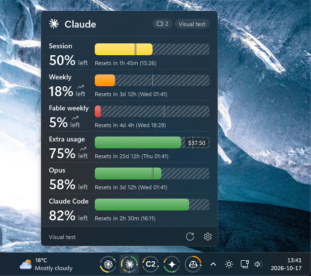

# Taskbar AI Usage

A [Windhawk](https://windhawk.net) mod that shows your Claude, Codex, Antigravity and GitHub
Copilot usage limits as ring tiles on the Windows 11 taskbar. Click a tile for a Fluent flyout with
every limit, its reset time and your pace.

## Install

In Windhawk, open **Explore**, search for **Taskbar AI Usage** and install it. If you use Taskbar AI
Quota Bars, disable it first so both mods don't poll the same accounts.

Claude Code, Codex, Visual Studio and GitHub CLI sign-ins on the PC are picked up automatically.
Add other accounts from the tile's right-click menu under **Settings**.

The full description is on the mod's page in Windhawk.

## Source

[`taskbar-ai-usage.wh.cpp`](taskbar-ai-usage.wh.cpp) is the whole mod. Windhawk compiles it when
you install it.

## Credits

Based on [Taskbar AI Quota Bars](https://github.com/Cleroth/windhawk-taskbar-ai-quota) by Cleroth.
The flyout and button styling come from
[Taskbar Fluent Media Player](https://github.com/Salyts/Taskbar-Fluent-Media-Player) by Salyts.
See [NOTICE.md](NOTICE.md).

## License

MIT. See [LICENSE](LICENSE).

Found a bug? [Open an issue](https://github.com/Sof2245/taskbar-ai-usage/issues).
